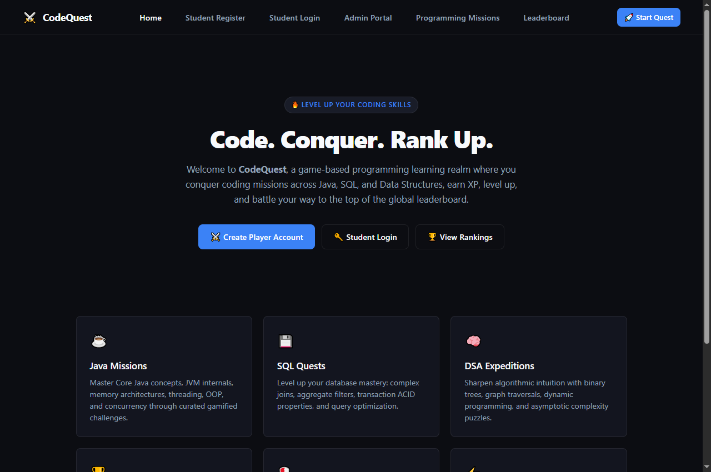
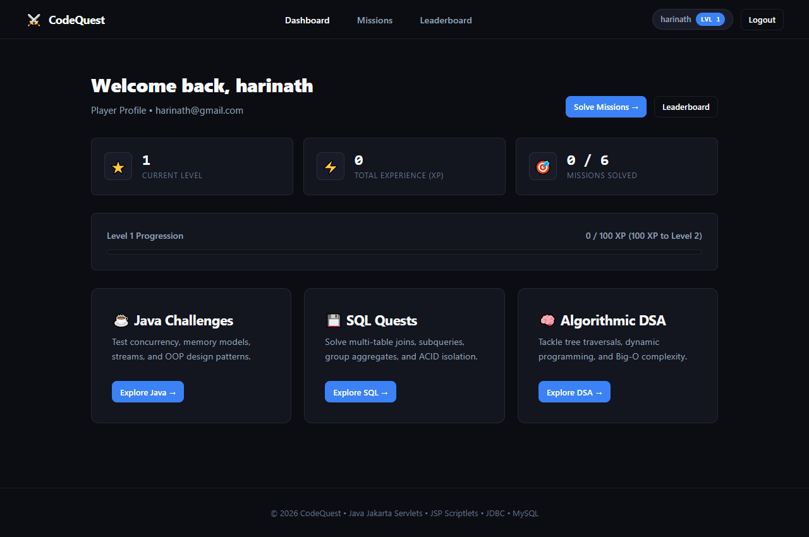
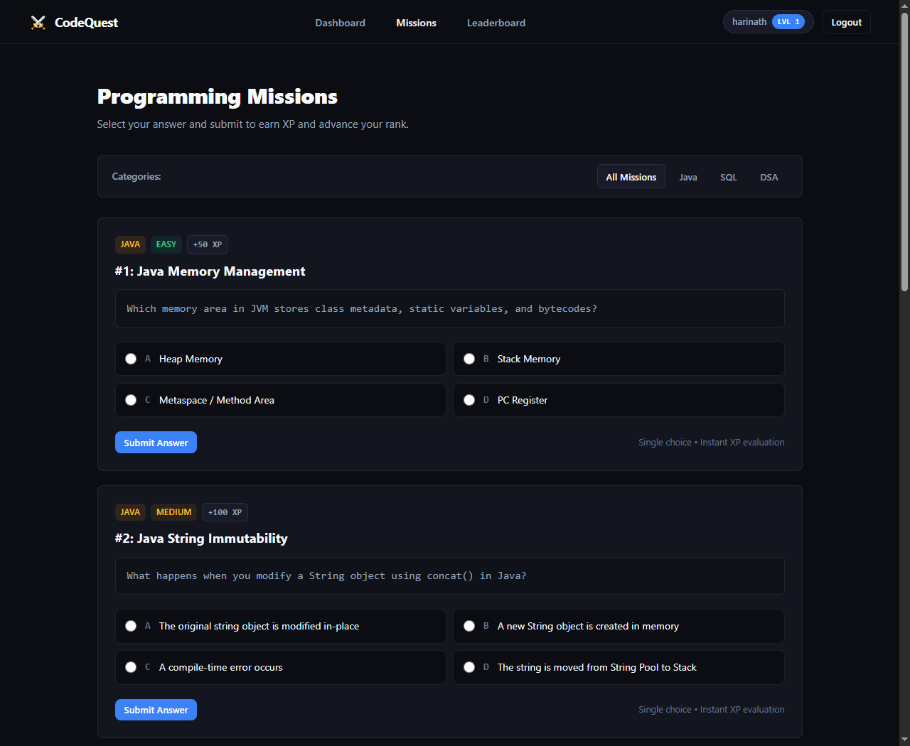
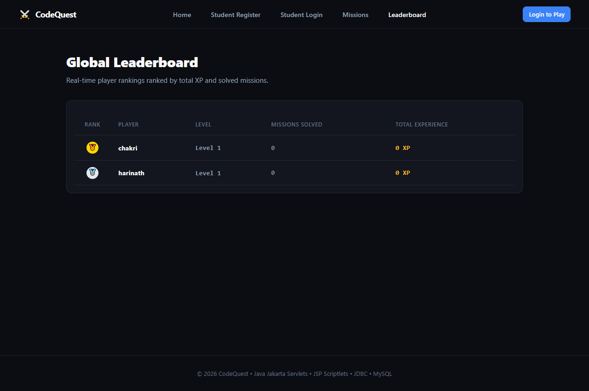
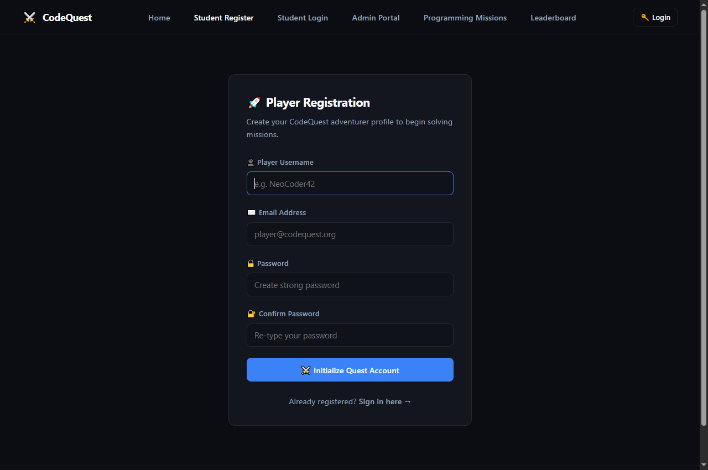
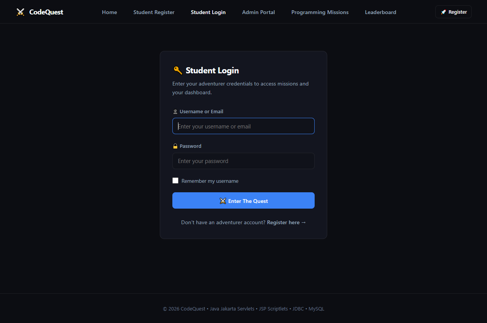
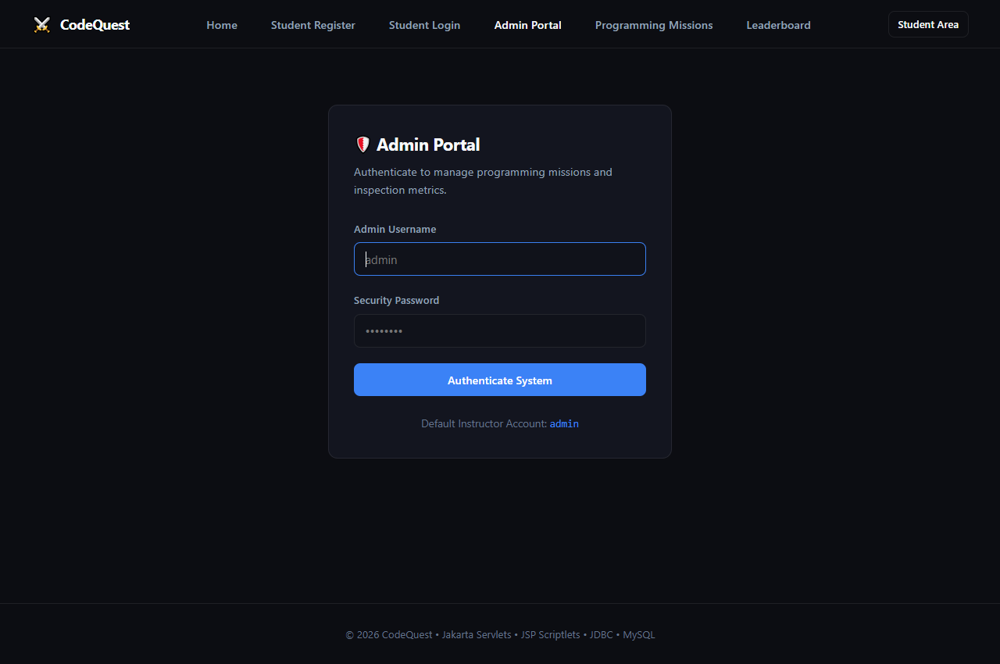
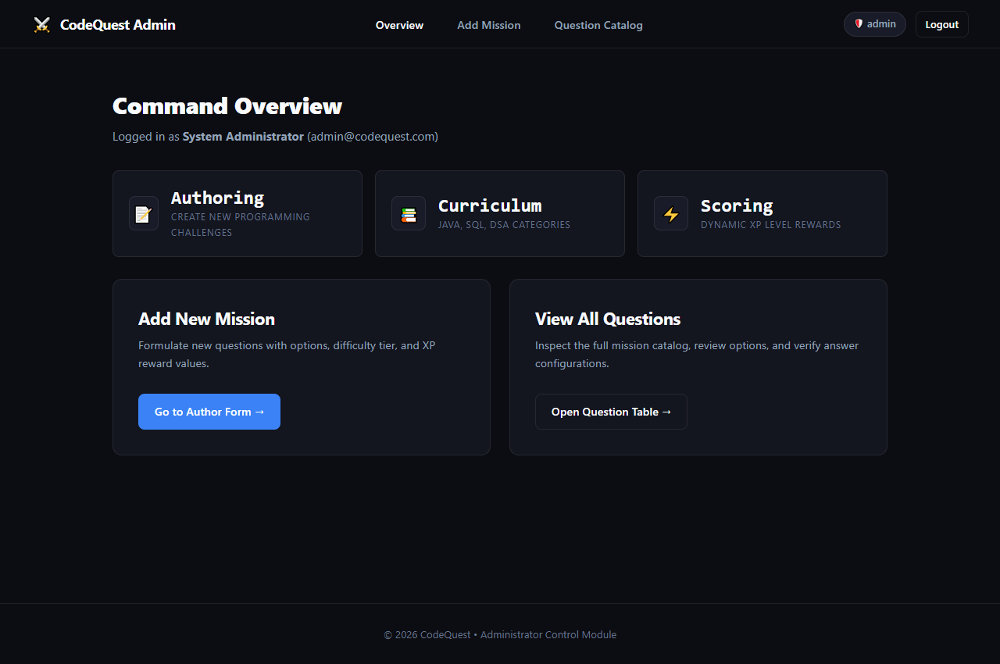
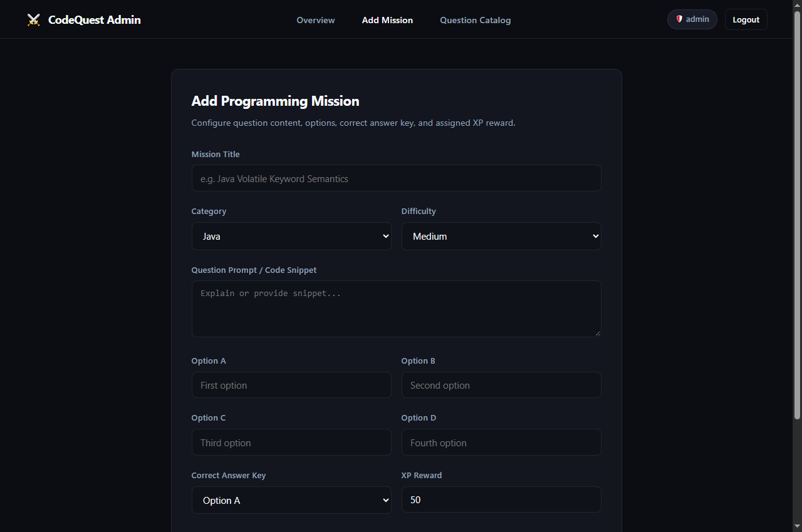
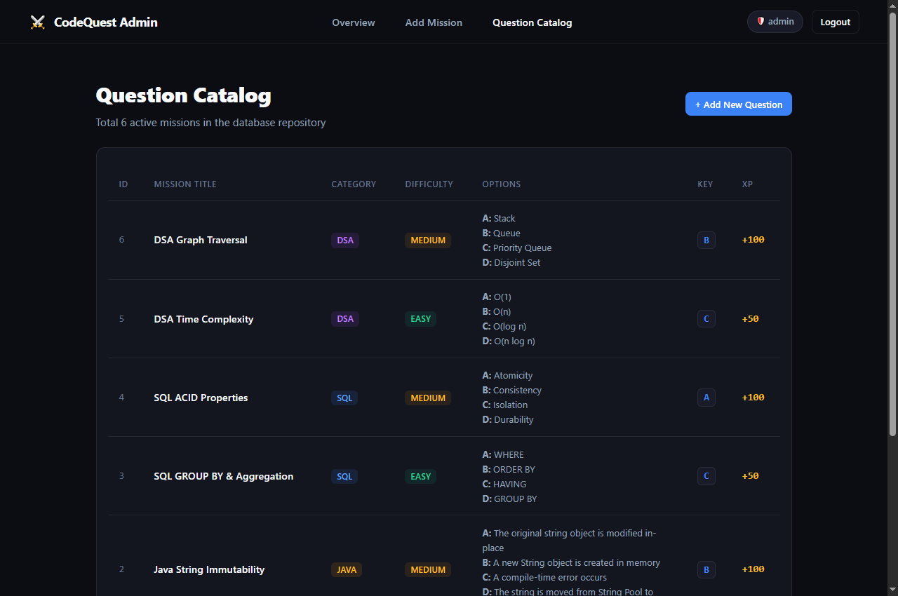

# ⚔️ CodeQuest — Gamified Programming Learning Platform

[](https://www.oracle.com/java/)
[-red.svg?style=flat-square)](https://jakarta.ee/)
[](https://tomcat.apache.org/)
[](https://www.mysql.com/)
[](#)

> **CodeQuest** is a game-based dynamic web application designed for computer science students to master programming concepts across **Java**, **SQL**, and **Data Structures & Algorithms (DSA)** through curated interactive missions, dynamic XP/level advancement mechanics, and a live competitive global leaderboard.

Built strictly in accordance with academic Dynamic Web Application specifications utilizing the **Model-View-Controller (MVC)** architectural design pattern on **Eclipse IDE**.

---

## 📸 Visual Showcase & Application Outputs

### 1. Landing Page (`index.html`)
Minimalist dark theme introduction showcasing the platform's core tracks (Java, SQL, DSA), player ranking metrics, and quick action launchpads.



---

### 2. Player Dashboard (`DashboardServlet` &rarr; `dashboard.jsp`)
Displays live player stats, current level, total XP, solved mission metrics, real-time level progress bar, and topic quick-links.



---

### 3. Programming Missions Catalog (`MissionServlet` &rarr; `missions.jsp`)
Interactive coding challenges categorized into **Java**, **SQL**, and **DSA** with difficulty badges (`Easy`, `Medium`, `Hard`) and instant XP rewards. Answer keys are protected on the server.



---

### 4. Global Leaderboard (`LeaderboardServlet` &rarr; `leaderboard.jsp`)
Real-time player rankings aggregated directly from MySQL database submissions, displaying rank medals (🥇, 🥈, 🥉), levels, completed missions, and highlighting the currently logged-in player.



---

### 5. Authentication & Session Management (`register.jsp` & `login.jsp`)
Clean student registration and authentication workflows with client-side & server-side validation, duplicate account prevention, error banners, and **Remember-Me HTTP Cookies**.

| Student Registration | Student Authentication |
|:---:|:---:|
|  |  |

---

### 6. Administrator Command Center (`admin-dashboard.jsp`)
Secure instructor/administrator operations portal to inspect curriculum status, author new missions, and manage the central database repository.

| Admin Authentication Portal | Operations Command Overview |
|:---:|:---:|
|  |  |

---

### 7. Mission Authoring & Question Management (`add-question.jsp` & `view-questions.jsp`)
Comprehensive administrative tooling to formulate new programming challenges and inspect the active question catalog.

| Mission Authoring Interface | Central Question Catalog |
|:---:|:---:|
|  |  |

---

## 🏛️ System Architecture & MVC Pattern

The application strictly follows the classical enterprise **Model-View-Controller (MVC)** architecture:

```
[ Client Browser ]
        │
        ├── HTTP Request (GET/POST)
        ▼
[ Jakarta EE Controllers / Servlets ]
  ├── com.codequest.servlet.RegisterServlet
  ├── com.codequest.servlet.LoginServlet / LogoutServlet
  ├── com.codequest.servlet.DashboardServlet
  ├── com.codequest.servlet.MissionServlet
  ├── com.codequest.servlet.SubmitAnswerServlet
  ├── com.codequest.servlet.LeaderboardServlet
  ├── com.codequest.servlet.AdminLoginServlet / AdminLogoutServlet
  └── com.codequest.servlet.AddQuestionServlet / ViewQuestionsServlet
        │
        ├── Business Logic & JDBC Transactions
        ▼
[ Data Access & Models (JavaBeans) ]
  ├── com.codequest.util.DBConnection (Thread-safe MySQL connection pool)
  └── com.codequest.model:
        ├── User.java
        ├── Admin.java
        ├── Mission.java
        ├── Submission.java
        └── LeaderboardEntry.java
        │
        ├── SQL Queries via PreparedStatements
        ▼
[ Relational Database (MySQL 8.0: codequest_db) ]
        │
        ├── Request Attributes & Session Scope
        ▼
[ Presentation Layer (Views: JSP + CSS3) ]
  ├── index.html
  ├── register.jsp / login.jsp
  ├── dashboard.jsp / missions.jsp / mission-result.jsp
  ├── leaderboard.jsp
  └── admin-login.jsp / admin-dashboard.jsp / add-question.jsp / view-questions.jsp
```

---

## ⚙️ Technology Stack

| Component | Technology | Version | Purpose |
|:---|:---|:---|:---|
| **Programming Language** | Java (JDK) | 25 | Backend server-side execution |
| **Web Container** | Apache Tomcat | 10.1.60 | Jakarta EE 10 / Servlet 6.0 engine |
| **Servlet Specification** | Jakarta Servlet | 6.0 (`jakarta.servlet.*`) | HTTP request routing & controllers |
| **View Technology** | JavaServer Pages (JSP) | 3.1 | Dynamic presentation with scriptlets |
| **Database** | MySQL Server | 8.0 | Persistent relational storage |
| **Database Driver** | MySQL Connector/J | 26.7.0 / 8.x | High-performance JDBC bridge |
| **Styling** | Custom CSS3 | Modern Minimalist | Responsive dark gaming theme |
| **IDE** | Eclipse IDE for Enterprise Java | 2024 / 2025 | Dynamic Web Module 6.0 development |

---

## 🗄️ Database Schema (`codequest_db`)

The database consists of 4 normalized relational tables:

```sql
CREATE DATABASE IF NOT EXISTS codequest_db;
USE codequest_db;

-- 1. Student Users Table
CREATE TABLE IF NOT EXISTS users (
    id INT AUTO_INCREMENT PRIMARY KEY,
    username VARCHAR(50) NOT NULL UNIQUE,
    email VARCHAR(100) NOT NULL UNIQUE,
    password VARCHAR(255) NOT NULL,
    xp INT DEFAULT 0,
    level INT DEFAULT 1,
    created_at TIMESTAMP DEFAULT CURRENT_TIMESTAMP
);

-- 2. Administrators / Instructors Table
CREATE TABLE IF NOT EXISTS admins (
    id INT AUTO_INCREMENT PRIMARY KEY,
    username VARCHAR(50) NOT NULL UNIQUE,
    email VARCHAR(100) NOT NULL UNIQUE,
    password VARCHAR(255) NOT NULL,
    full_name VARCHAR(100) NOT NULL,
    created_at TIMESTAMP DEFAULT CURRENT_TIMESTAMP
);

-- 3. Programming Missions Repository Table
CREATE TABLE IF NOT EXISTS missions (
    id INT AUTO_INCREMENT PRIMARY KEY,
    title VARCHAR(150) NOT NULL,
    description TEXT NOT NULL,
    category ENUM('Java', 'SQL', 'DSA') NOT NULL,
    difficulty ENUM('Easy', 'Medium', 'Hard') NOT NULL,
    option_a VARCHAR(255) NOT NULL,
    option_b VARCHAR(255) NOT NULL,
    option_c VARCHAR(255) NOT NULL,
    option_d VARCHAR(255) NOT NULL,
    correct_option CHAR(1) NOT NULL,
    xp_reward INT DEFAULT 50,
    created_at TIMESTAMP DEFAULT CURRENT_TIMESTAMP
);

-- 4. Mission Submissions & Audit Log Table
CREATE TABLE IF NOT EXISTS mission_submissions (
    id INT AUTO_INCREMENT PRIMARY KEY,
    user_id INT NOT NULL,
    mission_id INT NOT NULL,
    selected_option CHAR(1) NOT NULL,
    is_correct BOOLEAN NOT NULL,
    submitted_at TIMESTAMP DEFAULT CURRENT_TIMESTAMP,
    FOREIGN KEY (user_id) REFERENCES users(id) ON DELETE CASCADE,
    FOREIGN KEY (mission_id) REFERENCES missions(id) ON DELETE CASCADE,
    UNIQUE KEY unique_user_mission (user_id, mission_id)
);
```

---

## 🚀 Quick Setup & Deployment Guide on Eclipse

### 1. Prerequisites
- Eclipse IDE for Enterprise Java and Web Developers.
- Apache Tomcat v10.1 configured as an Eclipse Server Runtime.
- MySQL Server 8.0 running on `localhost:3306`.

### 2. Import into Eclipse Workspace
1. Launch **Eclipse IDE**.
2. Click **File** &rarr; **Open Projects from File System...** (or **Import...** &rarr; **General** &rarr; **Existing Projects into Workspace**).
3. In **Directory...**, browse to:
   ```text
   C:\Users\NOTHING\eclipse-workspace\CodeQuest
   ```
4. Click **Finish**.

### 3. Verify Database Credentials
Open `src/main/java/com/codequest/util/DBConnection.java` and confirm database parameters:
```java
private static final String DB_URL  = "jdbc:mysql://localhost:3306/codequest_db?useSSL=false&allowPublicKeyRetrieval=true&serverTimezone=UTC";
private static final String DB_USER = "root";
private static final String DB_PASS = "Nothing_4456";
```

### 4. Run on Tomcat Server
1. In Eclipse **Project Explorer**, right-click `CodeQuest`.
2. Select **Run As** &rarr; **Run on Server**.
3. Choose **Apache Tomcat v10.1** &rarr; click **Finish**.
4. Open your browser and navigate to:
   ```text
   http://localhost:8080/CodeQuest/
   ```

---

## 🔑 Default Credentials for Evaluation

### Administrator Portal
- **URL**: `http://localhost:8080/CodeQuest/admin-login.jsp`
- **Username**: `admin`
- **Password**: `admin123`
- *Permissions*: Create missions, view complete database question catalog, inspect answer keys.

### Student Demo Account
- **URL**: `http://localhost:8080/CodeQuest/login.jsp`
- **Username**: `harinath`
- **Password**: `Hari123@`
- *Permissions*: Solve coding challenges, view dashboard stats, compete on global leaderboard.
*(New student accounts can also be created dynamically via `register.jsp`).*

---

## 🛡️ Security & Evaluation Highlights
1. **Protection against SQL Injection**: All database operations exclusively employ parameterized JDBC `PreparedStatement` instances.
2. **ACID Transaction Management**: Mission submissions, XP increments, and level advancements execute inside atomic database transactions (`conn.setAutoCommit(false)` with explicit `conn.commit()` and `conn.rollback()`).
3. **Answer Key Protection**: Correct answers are omitted from queries when serving questions to students, ensuring answer integrity against client-side inspection.
4. **Session Guard Filters**: Direct URL access to `DashboardServlet`, `missions.jsp`, or admin endpoints without an active session immediately redirects to the appropriate login portal.
5. **State Preservation via HTTP Cookies**: "Remember Me" credentials persist safely across browser restarts using standard HTTP Cookie headers.

---

&copy; 2026 CodeQuest. Developed for Dynamic Web Programming Evaluation.
